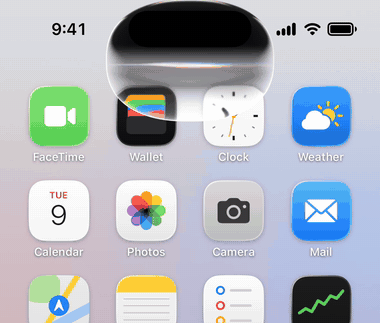
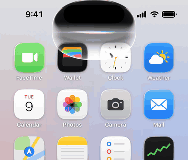
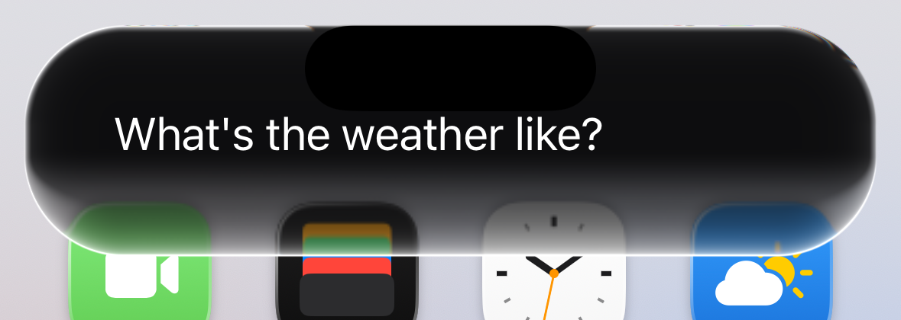
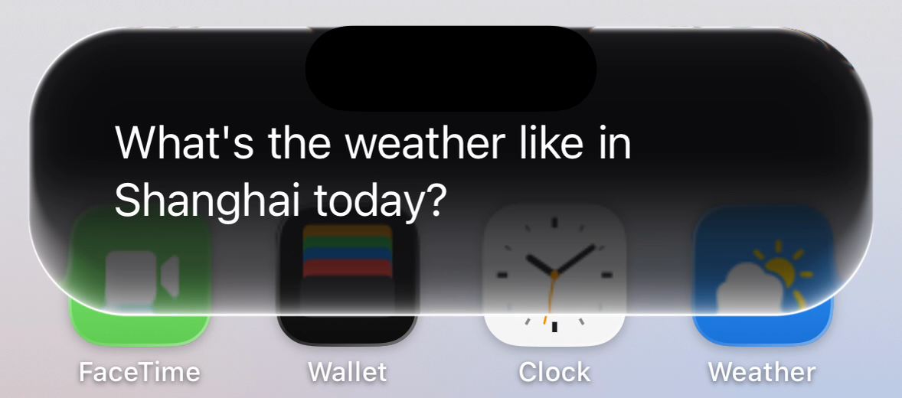
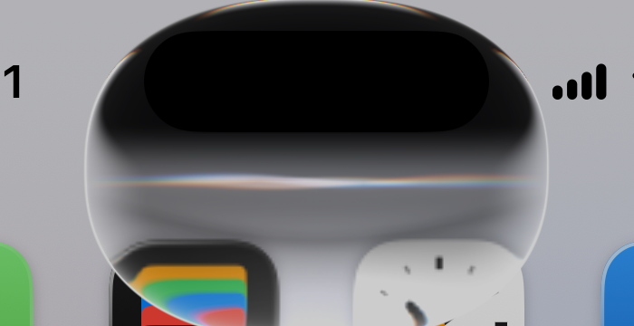
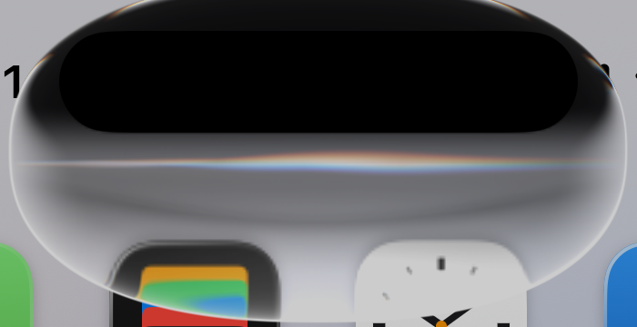
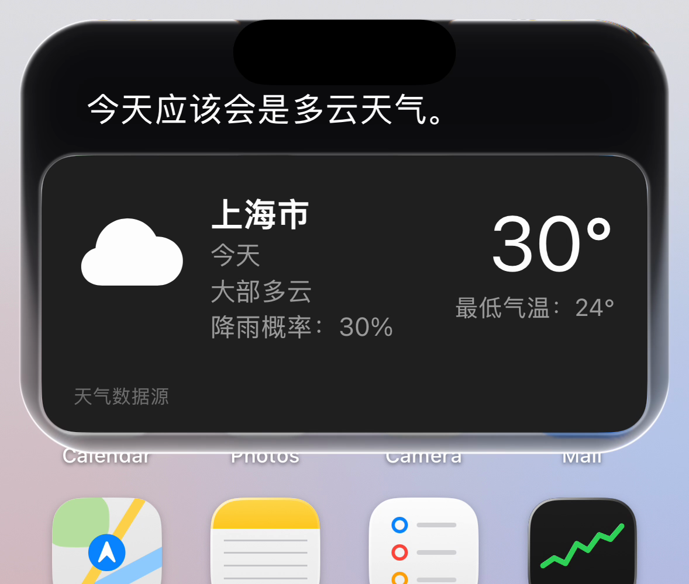

# Siri Glass for iOS 16.5

English | [简体中文](README.zh-CN.md)

The iOS 27 style Siri liquid-glass drop, ported to jailbroken iOS 16.5. When Siri is invoked, a drop of glass pours out of the Dynamic Island, refracts the screen behind it, reacts to Siri's state and your voice, and replaces the Siri orb at the bottom of the screen.

Based on [haplollc/SiriGlass](https://github.com/haplollc/SiriGlass) (MIT). This project is MIT licensed, see [LICENSE](LICENSE).

- **Target device:** iPhone 14 Pro, iOS 16.5, Dopamine 2.4.9 (roothide). Other iOS 16 devices with a Dynamic Island should work in theory, untested.
- **Version:** 0.1.35 (**work in progress, development has stopped**). Siri's words move into the Dynamic Island: the drop grows into an iOS 27 style glass card that follows the text, words fade in one by one out of a blur, and the original text at the bottom is hidden. Native result cards (weather and so on) are placed inside the glass, the status bar makes way for the glass, and a swipe up on the glass or the island dismisses it at any time.

## Preview

Recorded in the simulator. As the glass widens, the status bar shrinks and yields item by item, the way it does for a Dynamic Island expansion, and comes back as the glass folds. On a device the tweak drives the system status bar; in the simulator the demo mimics the same logic.

| Words appear one by one, the glass grows with the text | A native card (weather) inside the glass |
|---|---|
|  |  |

| One line | Two lines |
|---|---|
|  |  |

| Normal Dynamic Island | Island widened by a Live Activity |
|---|---|
|  |  |



## Disclaimer

This is an unofficial project and is not affiliated with or endorsed by Apple. Siri, iOS and Dynamic Island are trademarks of Apple Inc. The tweak hooks private, undocumented SpringBoard and Siri APIs on a jailbroken device, which can break with any iOS update and may cause SpringBoard crashes or safe mode. Use at your own risk; the software is provided as is (see [LICENSE](LICENSE)).

## Credits

- [haplollc/SiriGlass](https://github.com/haplollc/SiriGlass) (MIT): the original drop.
- [DnV1eX/LiquidGlassKit](https://github.com/DnV1eX/LiquidGlassKit): inspiration for the refraction shader (no code copied).

## Layout

| Directory | What it is |
|---|---|
| [src/SiriGlass](src/SiriGlass) | Fork of upstream SiriGlass: lowered to iOS 16, glass and refraction drawn with Metal |
| [src/SiriGlassHost](src/SiriGlassHost) | Swift dynamic library that wraps SiriGlass as `SGHost`, callable from Objective-C |
| [src/SiriGlassTweak](src/SiriGlassTweak) | SpringBoard tweak: takes over the Siri orb, drives the drop, packages the deb |
| [src/SiriGlassTweak/SiriGlassPrefs](src/SiriGlassTweak/SiriGlassPrefs) | PreferenceLoader settings pane (on/off, debug log) |
| [tools](tools) | Build script |

## Build

Needs Xcode, [roothide Theos](https://github.com/roothide/theos) (at `~/theos-roothide`) and `ldid`.

```bash
tools/build_deb.sh
```

The deb ends up in `src/SiriGlassTweak/packages/`.

## Install

Download the deb from [Releases](../../releases) (roothide / arm64e, tested on iOS 16.5), copy it to the phone, install it with Filza or Sileo, then respring or re-jailbreak. The settings pane is at Settings → Siri Glass.

## Usage

- Invoke Siri with the side button or "Hey Siri", or **swipe down from the Dynamic Island**.
- When a Live Activity widens the island, the drop widens and rises so the glass covers the island's two top corners.

## Known bugs (self-check)

**This is unfinished and no longer developed.** What is known to be broken; contributions welcome:

- Native cards inside the glass (for example the alarm list for "open alarms") can't be scrolled or tapped on a device: touches don't reach the card, and the cause was not found (see the code around `SiriSharedUICompactResultView` in `src/SiriGlassTweak/Tweak.x`).
- The refraction backdrop is refreshed by taking screenshots that exclude the glass window. Only tested on iOS 16.5 / Dopamine; retest on other devices or systems.
- Swipe down from the island to invoke Siri and swipe up to dismiss: the gestures may conflict with the system island's own gestures.
- The drop looks flat when the island is widened by a Live Activity.
- The settings pane needs PreferenceLoader.
- Debug logging is off by default; see [src/SiriGlassTweak/README.md](src/SiriGlassTweak/README.md) to turn it on.
